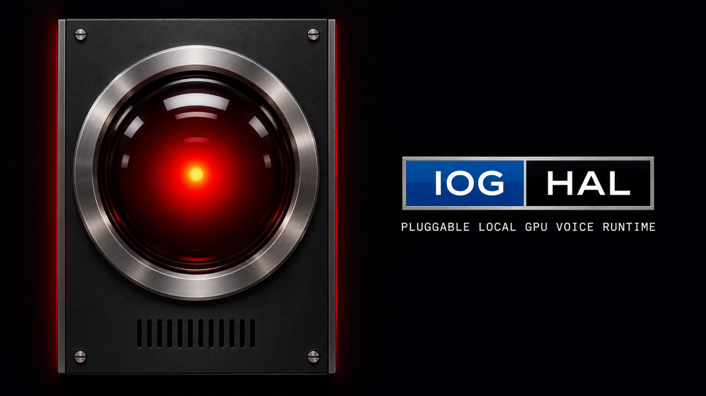
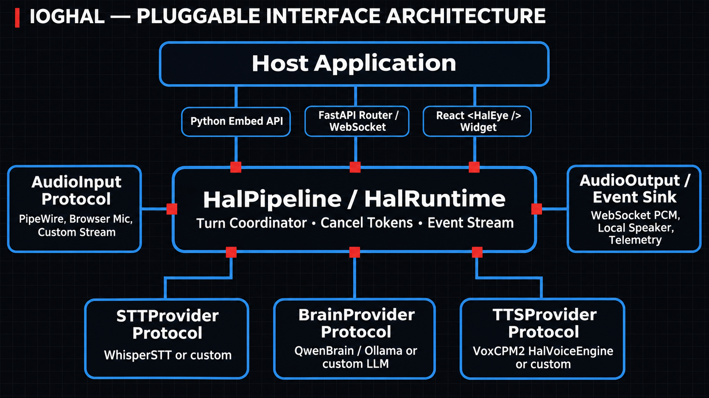

<p align="center">
  
</p>

<h1 align="center">IOGHAL</h1>

<p align="center">
  <strong>Pluggable local GPU Push-to-Talk voice runtime powered by VoxCPM2, Ollama Qwen, and Whisper Large v3.</strong>
</p>

<p align="center">
  <a href="LICENSE"></a>
  
  
  
</p>

---

IOGHAL runs a complete local speech-to-speech loop on a single GPU. It captures microphone audio, transcribes speech with CUDA Whisper Large v3, streams replies sentence by sentence from a local Ollama Qwen model, and synthesizes 48 kHz mono cloned speech in real time with OpenBMB VoxCPM2.

Every core stage sits behind a runtime-checkable Python `Protocol`. You can run IOGHAL as a standalone React web console, a PyQt6 desktop application, or a terminal interface, or embed its pipeline, FastAPI router, and React optical eye component directly into a larger application.

---

## System Architecture

<p align="center">
  
</p>

```text
+---------------------------------------------------------------------------------------------------+
|                                   CLIENT / HOST APPLICATION                                       |
|  +---------------------------+   +---------------------------+   +-----------------------------+  |
|  | React Web Console (Vite)  |   | PyQt6 Desktop / CLI App   |   | Host App (Python / FastAPI) |  |
|  | <HalEye /> + HalAudioPlay |   | HalEyeWidget + PortAudio  |   | HalPipeline / HalRouter     |  |
|  +-------------+-------------+   +-------------+-------------+   +--------------+--------------+  |
+----------------|-------------------------------|--------------------------------|-----------------+
                 | JSON Control +                | Direct Call                    | Protocol / WS
                 | Binary PCM [u32 tid | f32[]]  |                                |
                 v                               v                                v
+---------------------------------------------------------------------------------------------------+
|                                      IOGHAL CORE RUNTIME                                          |
|                                                                                                   |
|   +------------------------+          +-------------------------------------------------------+   |
|   | AudioInput Protocol    |          | HalRuntime (Shared GPU Lock + Per-Conn Isolation)     |   |
|   | - PipeWire MicRecorder |          |  - Single-writer async WebSocket queue (non-blocking) |   |
|   | - Browser WebAudio Mic |          |  - Client wire turn_id + internal cancel generation   |   |
|   +-----------+------------+          |  - Exclusive host-mic ownership (loopback-guarded)    |   |
|               | 16 kHz mono float32   +---------------------------+---------------------------+   |
|               v                                                   |                               |
|   +---------------------------------------------------------------v---------------------------+   |
|   |                                     HalPipeline.run_turn()                                |   |
|   |                                                                                           |   |
|   |  +----------------------+      +---------------------------+      +--------------------+  |   |
|   |  | STTProvider          | text | BrainProvider             | sent | TTSProvider        |  |   |
|   |  | WhisperSTT (CUDA)    +----->| QwenBrain (Ollama Stream) +----->| HalVoiceEngine     |  |   |
|   |  | - Local-first cache  |      | - LoreIndex recall        |      | - VoxCPM2 48 kHz   |  |   |
|   |  | - Voiced energy gate |      | - Think-tag stripper      |      | - Prompt cache     |  |   |
|   |  | - Domain prompt IDs  |      | - Abbreviation-safe split |      | - Phrase PCM cache |  |   |
|   |  +----------+-----------+      +---------------------------+      +---------+----------+  |   |
|   |             ^                                                               ^             |   |
|   |             +------------------- Shared threading.Lock (gpu_lock) ----------+             |   |
|   +-----------------------------------------------------------------------------+-------------+   |
+---------------------------------------------------------------------------------|-----------------+
                                                                                  |
                                   48 kHz Float32 PCM Chunks + HalEvent Stream    |
                                   (deferred audio_start, barge-in cancel, RTF)   |
                                                                                  v
                                              [ Client Audio Playback & Reactive Optical Eye ]
```

---

## Pluggable Interfaces

<p align="center">
  
</p>

IOGHAL separates transport, UI, and model inference into small interfaces in [src/hal9000/interfaces.py](src/hal9000/interfaces.py):

| Interface | File | Default Implementation | Purpose |
|---|---|---|---|
| `STTProvider` | `src/hal9000/interfaces.py` | `WhisperSTT` (`stt.py`) | Converts mono float32 audio to text with auto-resampling to 16 kHz. |
| `BrainProvider` | `src/hal9000/interfaces.py` | `QwenBrain` (`brain.py`) | Streams complete spoken sentences with cancellation checks and isolated history. |
| `TTSProvider` | `src/hal9000/interfaces.py` | `HalVoiceEngine` (`tts.py`) | Streams 48 kHz mono float32 PCM chunks with pre-cached voice conditioning. |
| `AudioInput` | `src/hal9000/interfaces.py` | `MicRecorder` (`audio.py`) | Captures push-to-talk audio with bounded duration and live RMS telemetry. |
| `HalPipeline` | `src/hal9000/pipeline.py` | `HalPipeline` | Runs one cancellable STT -> Brain -> TTS turn and emits typed `HalEvent` objects. |
| `create_hal_router` | `src/hal9000/server.py` | FastAPI `APIRouter` | Mounts `/api/health` and `/ws` into any existing FastAPI server. |
| `<HalEye />` / `HalAudioPlayer` | `web/src/index.ts` | React 19 + WebAudio | Embeddable reactive optical lens and framed-PCM audio playback engine. |

### 1. Plug into a Python Application

Inject any custom `STTProvider`, `BrainProvider`, or `TTSProvider` into `HalPipeline`:

```python
import threading
from hal9000 import HalEvent, HalPipeline, HalVoiceEngine, QwenBrain, WhisperSTT

pipeline = HalPipeline(
    stt=WhisperSTT(),
    brain=QwenBrain(model="qwen3.5:9b-q8_0", user_name="Charles"),
    tts=HalVoiceEngine(reference_wav="voices/hal9000_ref.wav", inference_timesteps=6),
)

def on_event(event: HalEvent) -> bool:
    if event.kind == "hal_partial":
        print("HAL:", event.payload["text"])
    elif event.kind == "audio_chunk" and event.pcm is not None:
        # Forward 48 kHz mono float32 PCM to your host application's audio sink
        pass
    return True

result = pipeline.run_turn(
    turn_id=1,
    cancel_event=threading.Event(),
    on_event=on_event,
    user_text="Good afternoon, HAL. Confirm all systems.",
)
```

### 2. Mount into an Existing FastAPI Server

Attach IOGHAL to any FastAPI service at a custom URL prefix with injected configuration or custom providers:

```python
import asyncio
from contextlib import asynccontextmanager
from fastapi import FastAPI
from hal9000 import HalConfig, HalRuntime, create_hal_router

runtime = HalRuntime(
    HalConfig(
        model="qwen3.5:9b-q8_0",
        steps=6,
        user_name="Charles",
        allowed_origins=("http://localhost:3000",),
    )
)

@asynccontextmanager
async def lifespan(app: FastAPI):
    runtime.set_loop(asyncio.get_running_loop())
    runtime.start_background_load()
    try:
        yield
    finally:
        runtime.shutdown()

app = FastAPI(lifespan=lifespan)
app.include_router(create_hal_router(runtime, prefix="/hal"))
```

### 3. Embed the React Optical Eye and Audio Player

Import the standalone canvas widget and framed PCM player from [web/src/index.ts](web/src/index.ts):

```tsx
import { useRef } from 'react';
import { HalEye, HalAudioPlayer, decodeFramedPcm } from './web/src';
```

`HalAudioPlayer` handles prebuffering, underrun recovery, mute state, anti-pop gain ramps on barge-in, autoplay suspension callbacks, and one-click replay of the last completed transmission.

---

## WebSocket Wire Protocol

The `/ws` endpoint uses JSON control messages and framed binary PCM chunks over a single ordered per-connection writer queue.

### Client to Server (JSON)

| Type | Fields | Behavior |
|---|---|---|
| `ptt_start` | `capture_id` | Acquires loopback host microphone and starts 16 kHz capture. |
| `ptt_stop` | `turn_id`, `capture_id` | Stops host microphone and runs STT -> Brain -> TTS under `turn_id`. |
| `audio_b64` | `turn_id`, `pcm_b64`, `sample_rate` | Submits browser-captured float32 PCM (validated up to 30 s, 8–96 kHz). |
| `text` | `turn_id`, `text` | Runs Brain -> TTS directly (up to 4,000 characters). |
| `interrupt` | `turn_id`, `silent?` | Cancels the active turn and stops local capture. |
| `set_model` | `model` | Switches the active Ollama model for the current connection. |
| `set_steps` | `steps` | Updates per-connection VoxCPM2 diffusion steps (`2` to `20`). |
| `reset` | `turn_id` | Cancels active work and clears the connection's conversation history. |

### Server to Client

- **JSON messages:** `system_status`, `state`, `capture_failed`, `capture_limit`, `mic_level`, `transcript`, `audio_start`, `hal_partial`, `metrics`, `audio_end`, `cleared`, and `error`.
- **Binary PCM frames:** Every binary WebSocket frame starts with a 4-byte little-endian `uint32` `turn_id` header followed by little-endian `float32` mono PCM samples at `sample_rate` Hz. The client drops any frame whose header does not match its active `turn_id`.

---

## Requirements

- Linux with an NVIDIA CUDA GPU (tested on Python 3.12 and PyTorch CUDA 13.0)
- [uv](https://docs.astral.sh/uv/) and Node.js 20+
- [Ollama](https://ollama.com/) running locally with at least one Qwen model (default: `qwen3.5:9b-q8_0`)
- [OpenBMB VoxCPM](https://github.com/OpenBMB/VoxCPM) checked out at `../VoxCPM` (editable local source configured in [pyproject.toml](pyproject.toml))
- A 48 kHz mono reference WAV clip at `voices/hal9000_ref.wav` (or set `HAL_REF_WAV` / `--ref-wav`; see [voices/README.md](voices/README.md))

---

## Quick Start

### 1. Install Dependencies and Build the Frontend

```bash
# Install Python dependencies into .venv
uv sync

# Build the React web console into web/dist
cd web && npm install && npm run build && cd ..
```

### 2. Pull a Local Qwen Model in Ollama

```bash
ollama pull qwen3.5:9b-q8_0
```

### 3. Add a Reference Voice Clip

Place a 5 to 12 second 48 kHz mono WAV clip at `voices/hal9000_ref.wav` (with an optional matching `voices/hal9000_ref.txt` transcript for Ultimate Cloning), or export `HAL_REF_WAV=/path/to/voice.wav`.

### 4. Run the Web Console

```bash
./run_hal9000_web.sh --host 127.0.0.1 --port 8765 --steps 6
```

Open `http://127.0.0.1:8765` in Brave or any Chromium/Firefox browser:

- **Hold Spacebar** (or press and hold the optical eye / PTT bar) to speak and release to send.
- **Quick-tap Spacebar** (`< 280 ms`) to latch listening; tap Spacebar again to send.
- **Press Escape** (or click `ESC`) at any time for instant barge-in cancellation.

### 5. Run Desktop (PyQt6) or Terminal CLI Mode

```bash
# PyQt6 desktop application
./run_hal9000.sh --steps 6

# Terminal Push-to-Talk mode
./run_hal9000.sh --cli --steps 6

# Standalone voice cloning + Whisper + Qwen verification script
uv run python test_clone.py --steps 6
```

---

## Repository Layout

```text
IOGHAL/
├── docs/assets/                # Hero banner, pipeline architecture, and interface diagrams
├── lore/                       # Optional local Markdown lore files for dynamic recall
├── src/hal9000/
│   ├── __init__.py             # Public Python SDK exports
│   ├── interfaces.py           # STTProvider, BrainProvider, TTSProvider, AudioInput, HalConfig
│   ├── pipeline.py             # Transport-agnostic HalPipeline turn coordinator
│   ├── audio.py                # PipeWire MicRecorder and StreamingAudioPlayer
│   ├── stt.py                  # Local-first CUDA WhisperSTT with speech activity gate
│   ├── brain.py                # Ollama QwenBrain, LoreIndex, think stripper, sentence splitter
│   ├── tts.py                  # VoxCPM2 HalVoiceEngine with prompt cache and phrase cache
│   ├── server.py               # FastAPI HalRuntime, create_hal_router(), WebSocket server
│   └── app.py                  # PyQt6 desktop GUI and terminal CLI application
├── tests/
│   └── test_hal9000.py         # Unit, protocol, framing, and concurrency test suite
├── voices/
│   └── README.md               # Voice reference setup instructions (WAV clips gitignored)
├── web/
│   └── src/
│       ├── index.ts            # Embeddable React component and audio client barrel export
│       ├── halClient.ts        # Framed PCM decoder, protocol types, HalAudioPlayer
│       ├── HalEye.tsx          # Reactive Canvas optical eye widget
│       ├── App.tsx             # Discovery One Push-to-Talk web console
│       └── styles.css          # Console layout and dark theme styles
├── pyproject.toml              # Package metadata, Apache-2.0 license, and direct dependencies
├── LICENSE                     # Apache License 2.0
└── test_clone.py               # End-to-end voice clone and round-trip verification script
```

---

## Verification

Run the Python test suite, linter, and TypeScript production build:

```bash
uv run python -m unittest discover -s tests -v
uv run ruff check src tests test_clone.py
cd web && npm run build
```

---

## License

Released under the [Apache License 2.0](LICENSE).
